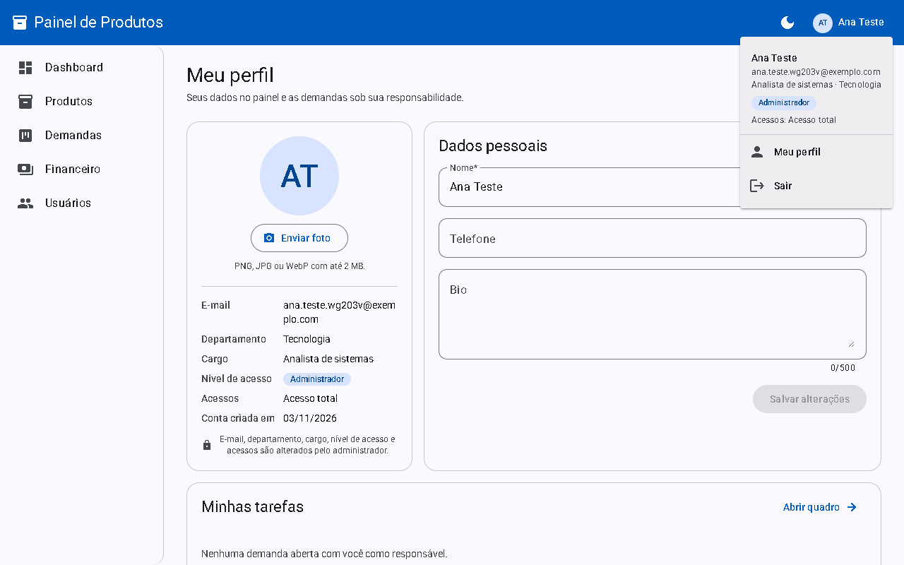
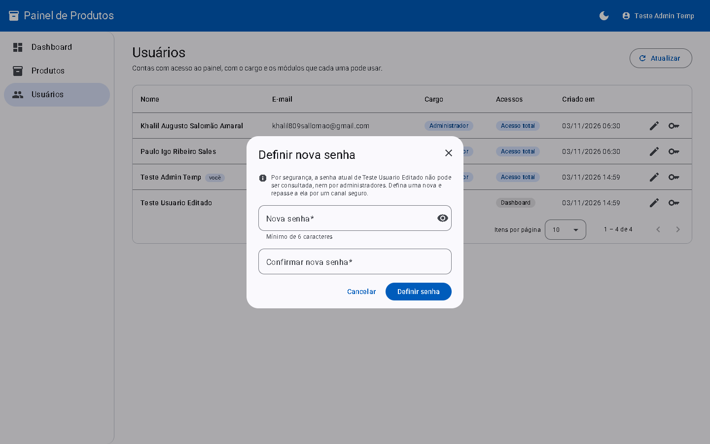

# Painel de Produtos

[](https://github.com/Chat809/product_module_interface/actions/workflows/ci.yml)


Painel administrativo em Angular para gerenciar produtos e estoque, com login por e-mail e senha ou pelo Google, registro, papéis e acessos por módulo. Consome a [Produtos API](https://github.com/Chat809/product_module_api) (Spring Boot), publicada no Render.


## Sumário

- [Links rápidos](#links-rápidos) · [Telas](#telas) · [Funcionalidades](#funcionalidades)
- [Login e sessão](#login-e-sessão), [Login com Google](#login-com-google) e [Acessos por módulo](#acessos-por-módulo)
- [Stack](#stack) · [Como executar](#como-executar) · [Testes](#testes) · [Build](#build)
- [Estrutura e rotas](#estrutura-e-rotas) · [Decisões](#decisões) · [Deploy na Vercel](#deploy-na-vercel) · [Referências](#referências)

## Links rápidos

| O quê | Link |
|---|---|
| Painel publicado (Vercel) | https://productmoduleinterface.vercel.app |
| API usada pelo painel (Render) | https://product-module-api.onrender.com/api/v1/produtos |
| Swagger UI da API (testar os endpoints no navegador) | https://product-module-api.onrender.com/swagger-ui.html |
| Health check da API | https://product-module-api.onrender.com/actuator/health |
| Repositório da API | https://github.com/Chat809/product_module_api |
| Execuções do CI | https://github.com/Chat809/product_module_interface/actions |

> A API roda no plano gratuito do Render: depois de um tempo sem uso, a primeira carga do painel pode levar até um minuto. O painel mostra um aviso enquanto isso.

## Telas

| Login com e-mail e senha ou Google | Criar conta |
|---|---|
|  |  |

| Usuários, cargos e acessos (somente admin) | Menu da conta, com papel, acessos e botão Sair |
|---|---|
|  |  |

| Edição de usuário com acessos por módulo | Definição de nova senha |
|---|---|
|  |  |

| Lista com busca instantânea e destaque | Modo escuro |
|---|---|
|  |  |

| Edição em modal | Movimentação de estoque com saldo previsto e histórico |
|---|---|
|  |  |


## Funcionalidades

**Acesso**

- **Tela de login** com e-mail e senha, botão **Entrar com Google** e link para criar conta. Erros de credencial aparecem no campo, e a senha é limpa depois de uma tentativa errada.
- **Criar conta** com nome, e-mail, senha e confirmação, com as mesmas regras da API, ou com um clique em **Criar conta com Google**. Um e-mail já cadastrado é avisado no próprio campo.
- **Login com Google:** quem já tem conta com o mesmo e-mail (usuário ou administrador) entra nela, com o cargo e os acessos de sempre; um e-mail novo ganha conta de usuário. Veja [Login com Google](#login-com-google).
- **Sessão** salva no navegador, renovada sozinha quando o token expira e encerrada pelo botão **Sair**. Depois do login, a pessoa volta para a página que tentou abrir.
- **Papéis e acessos por módulo:** cargo (Administrador ou Usuário) e módulos liberados (Dashboard, Produtos ou acesso total `*`). O menu mostra só o que foi liberado e quem não tem nenhum módulo vê "Nenhum módulo liberado". Veja [Acessos por módulo](#acessos-por-módulo).
- **Gestão de usuários (somente admin):** lista com nome, e-mail, cargo e acessos; modal de edição desses dados e modal de nova senha.

**Produtos e estoque**

- **Dashboard:** indicadores do estoque (produtos, itens, valor total em reais, esgotados e estoque baixo) e a lista "Precisa repor", com atalho para registrar entrada (só para quem também tem o módulo Produtos).
- **Busca instantânea:** filtra enquanto você digita, ignora acentos e maiúsculas, aceita vários termos em qualquer ordem e destaca o trecho encontrado, sem requisição a cada tecla.
- **Filtros e ordenação:** chips por situação do estoque com contagem, ordenação por nome, preço, estoque ou última atualização, e paginação em português.
- **Cadastro e edição em modal**, com as regras de validação da API e erros no campo correspondente. Fechar com alterações pendentes pede confirmação.
- **Movimentações de estoque:** entrada e saída com saldo previsto, aviso de estoque insuficiente e histórico.
- **Edição concorrente:** a versão lida vai no cabeçalho `If-Match`. Se outra pessoa alterou o produto, o painel avisa e recarrega os dados.

**Experiência**

- Toasts padronizados por tipo, modo escuro salvo no navegador, layout responsivo com menu recolhível no celular, skeleton no carregamento e aviso de espera enquanto a API "acorda" no plano gratuito.

## Login e sessão

| Como entrar | O que acontece |
|---|---|
| E-mail e senha | O painel envia os dados para `POST /auth/login` da API e guarda a sessão devolvida |
| Criar conta | `POST /auth/registro` cria a conta como Usuário (Dashboard e Produtos) e já abre a sessão |
| Google | O navegador vai ao Google pelo Supabase e volta em `/auth/callback`; o painel troca o código pela sessão em `POST /auth/google` |

Nos três casos a sessão tem o mesmo formato (`accessToken`, `refreshToken` e o usuário com cargo e acessos) e fica no `localStorage`. O `authInterceptor` anexa o token só às chamadas para a API e, quando ele expira, renova a sessão uma única vez com `POST /auth/refresh`. Se a renovação falhar, o painel avisa e volta ao login.

## Login com Google

O botão **Entrar com Google** (ou **Criar conta com Google**, no registro) usa o fluxo **PKCE**, em que o token nunca aparece na URL:

1. O painel gera um verificador aleatório, guarda no `sessionStorage` da aba e calcula o desafio, que é o SHA-256 do verificador.
2. O navegador vai para `https://<projeto>.supabase.co/auth/v1/authorize?provider=google` levando só o desafio. O Supabase manda para o Google, a pessoa escolhe a conta e o Supabase devolve o navegador para `/auth/callback?code=...`.
3. A tela "Entrando com Google..." envia o código e o verificador para a API (`POST /auth/google`), que troca os dois pela sessão no Supabase.
4. O painel guarda a sessão, cumprimenta pelo primeiro nome e abre a página pedida antes do login ou o primeiro módulo liberado.

**Quem pode entrar:** qualquer conta Google. Se o e-mail já tem conta no painel, criada pelo registro ou por um admin, o Google é vinculado a ela e a pessoa entra com o mesmo cargo, os mesmos acessos e o mesmo nome; a senha continua funcionando. Um e-mail novo ganha conta de Usuário com Dashboard e Produtos.

**Erros tratados:** cancelar no Google ("Login com Google cancelado."), código expirado ou já usado (mensagem da API), API que não responde a tempo e retorno aberto em outra aba, sem o verificador. Em todos, a pessoa volta para a tela de login com o aviso.

**Configuração:** o painel só precisa do endereço público do Supabase (`supabaseUrl` em `src/environments`), sem nenhuma chave. O Client ID e o Client Secret do Google ficam no Supabase. O passo a passo do Google Cloud e do Supabase está no [README da API](https://github.com/Chat809/product_module_api#login-com-google). Para testar localmente, `http://localhost:4200/auth/callback` precisa estar nas Redirect URLs do Supabase.

**Por dentro:** `core/auth/google.ts` gera o verificador e o desafio e monta o endereço; o `AuthService` expõe `entrarComGoogle()` e `concluirGoogle()`; `auth/botao-google` é o botão compartilhado pelo login e pelo registro; `auth/google-callback` é a tela de retorno.

## Stack

- Angular 22 (componentes standalone, signals, zoneless, novo control flow e rotas com lazy loading)
- Angular Material 22 (Material 3)
- Reactive Forms
- Vitest (testes unitários)

## Pré-requisitos

- Node.js `^22.22.3` ou `^24.15.0`
- npm

## Como executar

```bash
git clone https://github.com/Chat809/product_module_interface.git
cd product_module_interface
npm install
npm start
```

Acesse `http://localhost:4200`.

Em desenvolvimento, o painel consome a API local em `http://localhost:8080/api/v1`. Para subi-la, siga o README da [Produtos API](https://github.com/Chat809/product_module_api#como-executar) (`./mvnw spring-boot:run`). A API sobe com 15 produtos de exemplo e precisa da variável `SUPABASE_SECRET_KEY` para o login funcionar.

Para usar a API publicada no Render sem rodar o backend localmente:

```bash
npm start -- --configuration production
```

| Ambiente | Arquivo | URL da API |
|---|---|---|
| Desenvolvimento | `src/environments/environment.development.ts` | `http://localhost:8080/api/v1` |
| Produção | `src/environments/environment.ts` | `https://product-module-api.onrender.com/api/v1` |

Os dois arquivos também têm `supabaseUrl`, o endereço público do projeto Supabase usado só para iniciar o login com Google.

## Testes

```bash
npm test
```

São 149 testes com Vitest. Cada teste sobe um componente ou serviço isolado pelo `TestBed`, troca as dependências por objetos falsos (`vi.fn()`) ou intercepta o HTTP com `HttpTestingController`, e verifica o que aparece na tela e quais chamadas foram feitas.

| Arquivo | O que cobre |
|---|---|
| `produto.service.spec.ts` | URLs, parâmetros, métodos HTTP, corpo e cabeçalho `If-Match` de cada operação da API |
| `produto-filtro.spec.ts` | Normalização sem acentos, filtro por termos e situação, ordenação e destaque |
| `produto.store.spec.ts` | Carga única do catálogo e atualização local após cada operação |
| `produto-list.spec.ts` | Busca sem nova chamada à API, chips com contagem, ordenação, paginação, estado vazio e exclusão |
| `produto-form.spec.ts` | Validações, cadastro, edição com versão, conflito 409 e erros retornados pela API |
| `movimentacao-dialog.spec.ts` | Histórico, saldo previsto, bloqueio de saída maior que o estoque e registro |
| `dashboard.spec.ts` | Indicadores do resumo, lista de reposição ordenada, atalho de entrada e atalhos escondidos sem o módulo Produtos |
| `error.interceptor.spec.ts` | Mensagem exibida para cada status (sem conexão, 400, 401, 403, 409, 422 e erro genérico) |
| `auth.service.spec.ts` | Login, registro, login com Google (verificador guardado, endereço do Supabase só com o hash, troca do código e retorno sem login iniciado), sessão salva e restaurada, renovação única para chamadas simultâneas, módulos liberados, rota inicial, atualização da própria conta e saída |
| `google.spec.ts` | Verificador PKCE de 43 caracteres, desafio S256 conferido com o exemplo da RFC 7636 e endereço de autorização |
| `botao-google.spec.ts` e `google-callback.spec.ts` | Botão que leva a rota de volta e trava enquanto abre o Google; retorno com sucesso, cancelamento, erro do provedor, código recusado, tempo limite e outra aba |
| `acessos.spec.ts` | Regra de acesso igual à da API: admin acessa tudo, `*` sem o módulo de usuários, padrão para sessões antigas e descrição em texto |
| `auth.interceptor.spec.ts` | Token só nas chamadas à API, renovação e repetição da requisição em 401, logout se a renovação falhar |
| `auth.guards.spec.ts` | Redirecionamento ao login guardando a rota, bloqueio por módulo levando ao primeiro módulo liberado e saída do login para quem já entrou |
| `login.spec.ts` | Validação, cumprimento, retorno à rota pedida, limpeza da senha em caso de erro, despertar da API, tempo limite e botão do Google |
| `registro.spec.ts` | Regras iguais às da API, confirmação de senha, e-mail já cadastrado, erros por campo, despertar da API, tempo limite e botão do Google |
| `usuario.service.spec.ts` e `usuario-list.spec.ts` | Listagem paginada com cargo e acessos, marcação da própria conta, edição aplicada na linha e na sessão, e nova senha |
| `usuario-form.spec.ts` | Módulos marcados, acesso total `*`, promoção a admin, cargo travado na própria conta, e-mail de outra conta (409) e erros por campo |
| `senha-dialog.spec.ts` | Aviso de que a senha atual não pode ser vista, validação, confirmação e recusa da API |
| `espera.spec.ts` | Aviso de demora depois de alguns segundos e desistência com tempo limite |
| `tema.service.spec.ts` | Preferência do sistema, escolha salva e troca de tema |
| `paginador-intl.spec.ts` | Rótulos da paginação em português |
| `toast.spec.ts` | Emoji por tipo, papel de acessibilidade e fechamento pelo botão X |
| `app.spec.ts` | Rotas: sem sessão, abre o login guardando a rota pedida; com sessão, abre o primeiro módulo liberado e bloqueia os demais; sem nenhum módulo, tela de sem acesso; registro acessível sem login |

O workflow de CI (`.github/workflows/ci.yml`) roda o build e os testes a cada push e pull request.

## Build

```bash
npm run build
```

Os arquivos são gerados em `dist/product-module-interface/browser`.

## Estrutura e rotas

```
src/app
├── app.config.ts             Providers: rotas, HttpClient com interceptors, locale pt-BR, moeda BRL e paginação em português
├── app.routes.ts             Rotas com lazy loading e guards
├── auth
│   ├── login, registro       Telas de entrar e de criar conta
│   ├── botao-google          Botão "Entrar com Google" compartilhado pelas duas telas
│   └── google-callback       Tela de retorno do Google, que troca o código pela sessão
├── core
│   ├── auth                  Sessão (AuthService), PKCE do Google, regras de acesso por módulo, interceptor do token e guards
│   ├── feedback              Toast padronizado e serviço de notificação
│   ├── http                  Interceptor que traduz os erros da API (RFC 9457) em avisos
│   ├── i18n                  Textos do paginador em português
│   ├── layout                Shell (barra superior, menu lateral por módulo e conteúdo) e tela de sem acesso
│   └── tema                  Modo claro/escuro
├── shared
│   ├── confirm-dialog        Diálogo de confirmação reutilizável
│   ├── loading               Indicador de carregamento com aviso de partida a frio
│   ├── skeleton              Linhas de carregamento da tabela
│   └── somente-numeros       Diretiva que limita campos a caracteres numéricos
├── dashboard                 Indicadores e lista de reposição
└── produtos
    ├── produto.model.ts      Tipos que espelham os DTOs da API
    ├── produto.service.ts    Comunicação HTTP com a API
    ├── produto.store.ts      Catálogo em memória compartilhado pelas telas
    ├── produto-filtro.ts     Funções puras de busca, filtro, ordenação e destaque
    ├── produto-list          Tabela com busca, filtros, ordenação e paginação
    ├── produto-form          Modal de cadastro e edição
    └── movimentacao-dialog   Modal de entrada/saída com histórico
└── usuarios                  Gestão de usuários (somente admin)
    ├── usuario.service.ts    Listagem, edição e nova senha
    ├── usuario-list          Tabela com cargo, acessos e ações
    ├── usuario-form          Modal de edição: nome, e-mail, cargo e acessos
    └── senha-dialog          Modal de nova senha
```

| Rota | Página | Acesso |
|---|---|---|
| `/login` | Entrar | Sem sessão |
| `/registro` | Criar conta | Sem sessão |
| `/auth/callback` | Retorno do login com Google | Público |
| `/` | Redireciona para o primeiro módulo liberado | Logado |
| `/dashboard` | Indicadores e reposição | Módulo `dashboard` |
| `/produtos` | Lista de produtos | Módulo `produtos` |
| `/usuarios` | Usuários, cargos e acessos | Administrador |
| `/sem-acesso` | Aviso de que nenhum módulo foi liberado | Logado |

## Acessos por módulo

Os acessos ficam na coluna `acessos` (jsonb) da tabela de perfis no Supabase e chegam ao painel junto com o usuário, no login e em `GET /usuarios`. A regra completa, incluindo o banco e a proteção das rotas na API, está no [README da API](https://github.com/Chat809/product_module_api#acessos-por-módulo).

| Valor | O que a pessoa vê |
|---|---|
| `["*"]` | Todos os módulos do seu cargo (administradores têm sempre `*`) |
| `["dashboard", "produtos"]` | Dashboard e Produtos (padrão de toda conta nova) |
| `["dashboard"]` | Só o Dashboard, sem os atalhos de registrar entrada e ver o catálogo |
| `["produtos"]` | Só a lista de produtos, que vira a página inicial |
| `[]` | A tela "Nenhum módulo liberado" |

O módulo **Usuários** é exclusivo de administradores, por isso não aparece entre as caixas de acesso.

**Como o administrador edita:** em **Usuários**, o ícone de lápis abre o modal com nome, e-mail, cargo e acessos. A caixa "Acesso total (`*`)" marca todos os módulos de uma vez. Desmarcada, ela libera a escolha de cada módulo. Ao escolher o cargo Administrador, as caixas somem, porque o acesso passa a ser sempre total. Na própria conta, o cargo fica travado, para que sempre reste ao menos um administrador.

**Senhas:** o ícone de chave abre "Definir nova senha". Não existe "ver senha": o Supabase guarda só o hash, então nem administradores conseguem ler a senha atual de alguém.

**Quando vale:** cargo e acessos novos chegam ao usuário afetado no próximo login ou na renovação automática da sessão (em até 1 hora). Quando o admin edita a própria conta, o painel atualiza a sessão na hora.

**Por dentro:** `core/auth/acessos.ts` tem a lista `MODULOS` (chave, rótulo, ícone e rota) e a função `podeAcessar`, com a mesma regra da API. O `AuthService` expõe `modulosLiberados()` e `rotaInicial()`. O menu lateral é montado a partir de `modulosLiberados()`, e cada rota usa `moduloGuard('dashboard' | 'produtos' | 'usuarios')`. Para criar um módulo novo no painel, basta incluí-lo em `MODULOS` e proteger a rota com `moduloGuard`.

## Decisões

- **Organização por responsabilidade:** `core` (infraestrutura da aplicação), `shared` (componentes reutilizáveis), `dashboard` e `produtos` (as funcionalidades).
- **Busca em memória:** a API pagina e busca no servidor, mas o painel carrega o catálogo uma vez (até 500 produtos, o maior tamanho de página aceito) e filtra no navegador. Assim a busca responde a cada tecla sem requisições nem espera pela API no plano gratuito. Para catálogos maiores, bastaria trocar o filtro local pelos parâmetros `busca`, `page` e `sort` da API.
- **Store com signals:** um serviço com `signal` e `computed` guarda o catálogo e o atualiza localmente após cadastrar, editar, movimentar ou excluir. Para este escopo, uma biblioteca de estado (como NgRx) seria complexidade sem ganho.
- **Modais em vez de páginas:** cadastrar, editar e movimentar acontecem sem sair da lista, preservando busca, filtros e página.
- **Tratamento de erros centralizado:** o interceptor exibe a mensagem de qualquer erro HTTP; os componentes tratam apenas o que é específico deles, como os erros por campo no formulário.
- **Autenticação pela API:** o painel não chama o Supabase nem conhece nenhuma chave dele; envia e-mail e senha à API, que devolve o token. No login com Google, o navegador só passa pelo Supabase, e a troca do código pela sessão também é feita pela API, com o verificador PKCE. Assim os três jeitos de entrar produzem a mesma sessão. O `authInterceptor` anexa o token apenas às chamadas para a URL da API e, em um 401, renova a sessão uma única vez (chamadas simultâneas compartilham a mesma renovação, porque o Supabase invalida o refresh token a cada uso). Ele fica por dentro do `errorInterceptor`, então o aviso de sessão expirada só aparece se a renovação falhar.
- **Guards de rota:** `authGuard` protege o layout inteiro e guarda a rota pedida para voltar depois do login; `moduloGuard` protege cada módulo e manda quem não tem acesso para o primeiro módulo liberado. A API também confere papel e acessos, então os guards são conveniência de navegação, não a barreira de segurança.
- **Concorrência pelo HTTP:** a versão do produto vai no cabeçalho `If-Match`, como recomenda a especificação do HTTP, e também no corpo, por compatibilidade.

## Deploy na Vercel

1. Importe o repositório na Vercel.
2. O preset **Angular** é detectado automaticamente. O `vercel.json` já define o comando de build, a pasta de saída e o redirecionamento das rotas para o `index.html`, para que recarregar a página em `/produtos` funcione.
3. Clique em **Deploy**.

A API libera CORS para `https://productmoduleinterface*.vercel.app` e `https://product-module-interface*.vercel.app`. Se o painel for publicado em outro domínio, adicione-o à variável `CORS_ALLOWED_ORIGINS` do serviço da API no Render.

## Referências

- [Angular](https://angular.dev/) e [Signals](https://angular.dev/guide/signals)
- [Angular Material](https://material.angular.dev/) e [Material Design 3](https://m3.material.io/)
- [Reactive Forms](https://angular.dev/guide/forms/reactive-forms)
- [Testes no Angular](https://angular.dev/guide/testing) e [Vitest](https://vitest.dev/)
- [HttpClient e interceptors](https://angular.dev/guide/http) e [guards de rota](https://angular.dev/guide/routing/route-guards)
- [Supabase Auth](https://supabase.com/docs/guides/auth) (usado pela API), [login com Google](https://supabase.com/docs/guides/auth/social-login/auth-google) e [fluxo PKCE](https://supabase.com/docs/guides/auth/sessions/pkce-flow)
- [RFC 7636: PKCE](https://www.rfc-editor.org/rfc/rfc7636)
- [MDN: ETag e If-Match](https://developer.mozilla.org/docs/Web/HTTP/Headers/If-Match)
- [RFC 9457: Problem Details for HTTP APIs](https://www.rfc-editor.org/rfc/rfc9457)
- [Vercel: deploy de projetos Angular](https://vercel.com/docs/frameworks/frontend/angular)
- [GitHub Actions](https://docs.github.com/actions)
