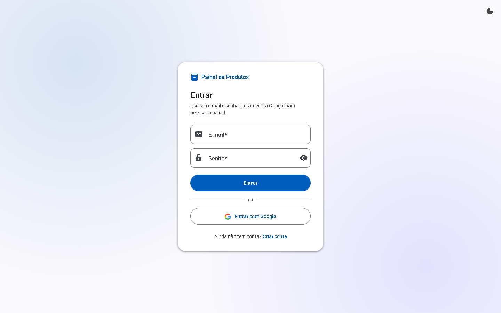
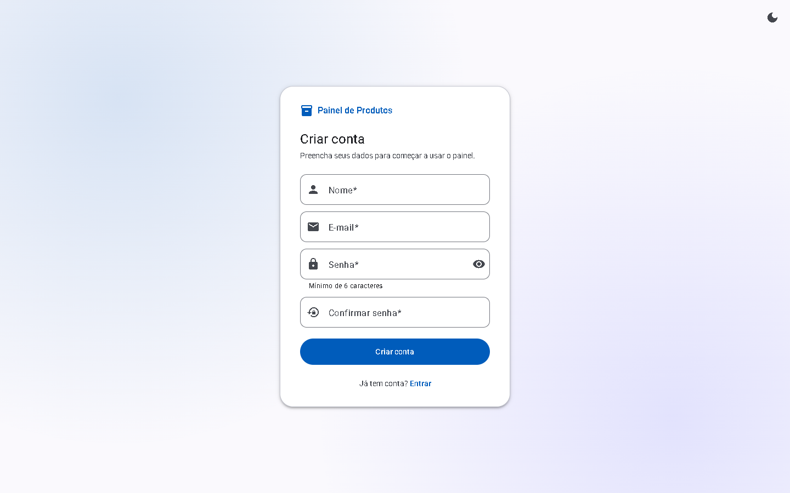
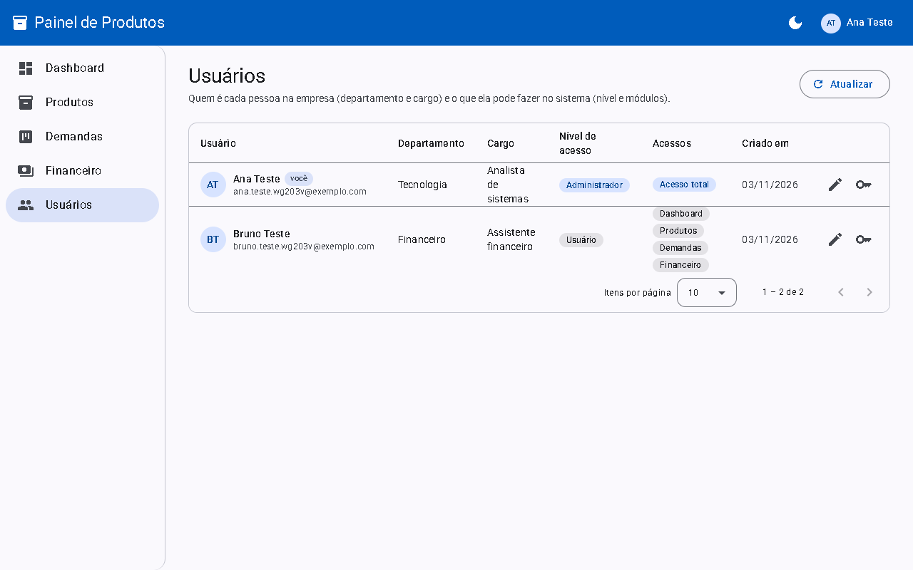
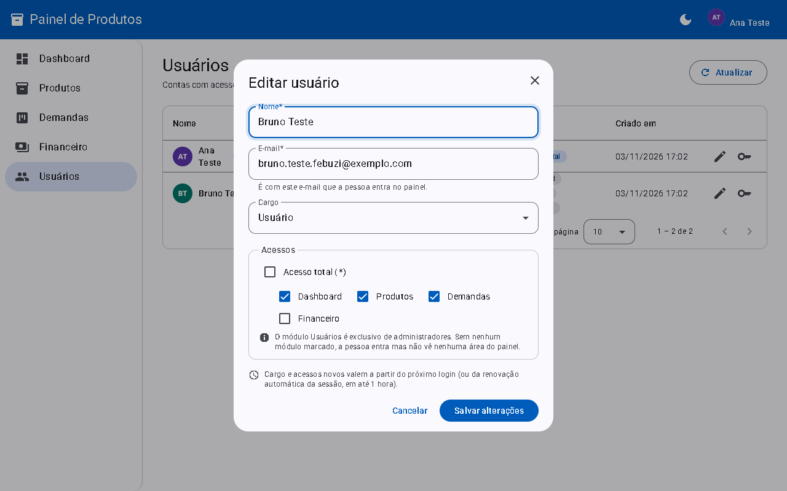
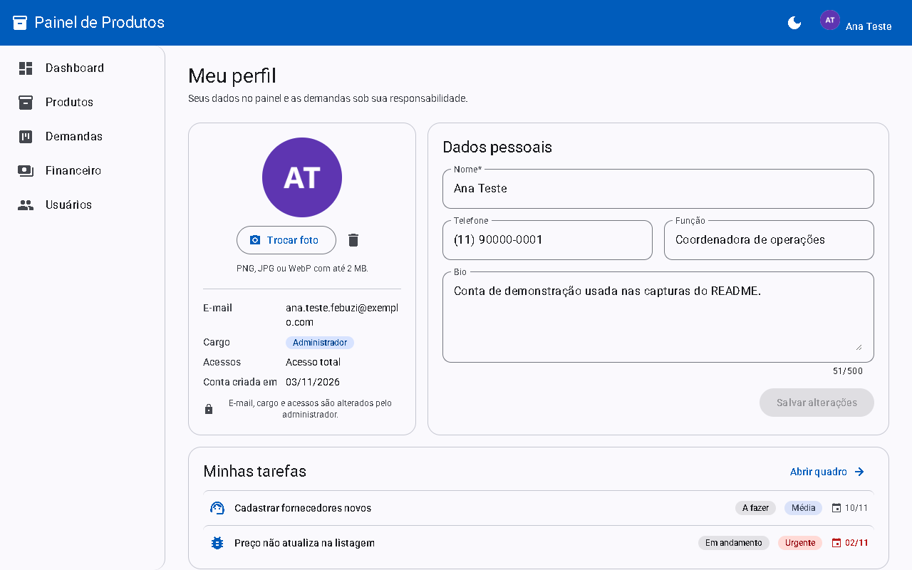
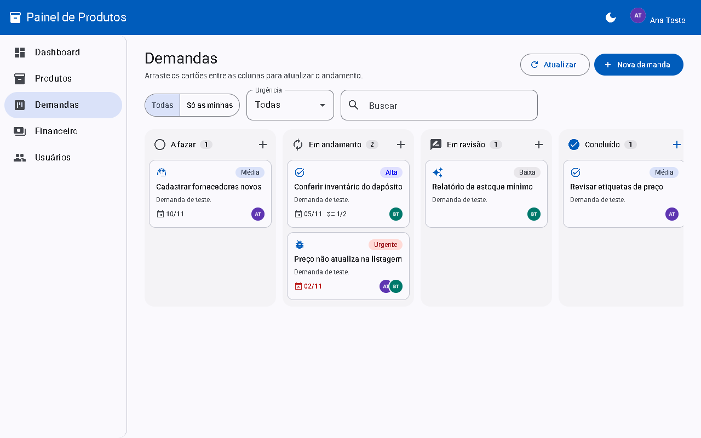
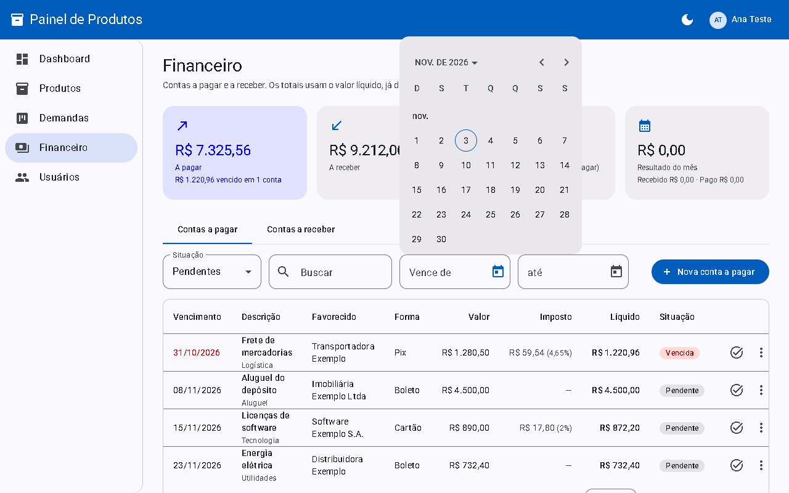

# Painel de Produtos

[](https://github.com/Chat809/product_module_interface/actions/workflows/ci.yml)


Painel em Angular que consome a [Produtos API](https://github.com/Chat809/product_module_api) (Spring Boot, publicada no Render). Começou como a interface do CRUD de produtos pedido no teste técnico e hoje também tem login (e-mail e senha ou Google), menu em abas e subabas com acesso por subaba, gestão de usuários, perfil com foto, um quadro Kanban de demandas, financeiro (com fornecedores e centros de custo), CRM (clientes, funil de leads e reclamações), notificações no sino, webhooks e relatórios com exportação em CSV.


## Sumário

- [Links rápidos](#links-rápidos) · [O que o painel cobre do teste](#o-que-o-painel-cobre-do-teste) · [O que tem no painel](#o-que-tem-no-painel)
- Funcionalidades em detalhe: [Login, Criar conta e Google](#login-criar-conta-e-google) · [Dashboard](#dashboard) · [Produtos e estoque](#produtos-e-estoque) · [Usuários e acessos](#usuários-e-acessos) · [Meu perfil](#meu-perfil) · [Demandas](#demandas) · [Financeiro](#financeiro) · [CRM](#crm) · [Notificações](#notificações) · [Webhooks e integrações](#webhooks-e-integrações) · [Relatórios](#relatórios)
- Referência técnica: [Stack](#stack) · [Como executar](#como-executar) · [Testes](#testes) · [Estrutura e rotas](#estrutura-e-rotas) · [Decisões](#decisões) · [Segurança](#segurança) · [Deploy na Vercel](#deploy-na-vercel) · [Referências](#referências)

## Links rápidos

| O quê | Link |
|---|---|
| Painel publicado (Vercel) | https://productmoduleinterface.vercel.app |
| API usada pelo painel (Render) | https://product-module-api.onrender.com/api/v1/produtos |
| Swagger UI da API | https://product-module-api.onrender.com/swagger-ui.html |
| Repositório da API | https://github.com/Chat809/product_module_api |
| Execuções do CI | https://github.com/Chat809/product_module_interface/actions |

> A API roda no plano gratuito do Render: depois de um tempo sem uso, a primeira carga pode levar até um minuto. O painel mostra um aviso enquanto isso.

## O que o painel cobre do teste

O PDF pede uma API de produtos; o painel é o cliente dela e usa todos os endpoints pedidos:

| Requisito da API | Onde aparece no painel |
|---|---|
| Consultar todos os produtos | Lista de produtos e Dashboard (`GET /produtos`) |
| Consultar produto por id | Modal de movimentação, que relê o produto depois de registrar entrada ou saída (`GET /produtos/{id}`) |
| Criar produto | Botão "Novo produto" (`POST /produtos`) |
| Atualizar produto | Modal de edição (`PUT /produtos/{id}`) |
| Remover produto | Ação de excluir na lista, com confirmação (`DELETE /produtos/{id}`) |

## O que tem no painel

Todas as telas e rotas (conferidas com `app.routes.ts`):

| Tela e rota | Quem acessa | O que dá para fazer |
|---|---|---|
| Login `/login` | Público (sem sessão) | Entrar com e-mail e senha ou com Google |
| Criar conta `/registro` | Público (sem sessão) | Criar conta de Usuário, com formulário ou Google |
| Retorno do Google `/auth/callback` | Público | Concluir o login com Google e voltar à página pedida |
| Raiz `/` e cada módulo (`/financeiro`, `/crm`...) | Logado | Redireciona para a primeira subaba liberada |
| Início > Dashboard `/inicio/dashboard` | `inicio/dashboard` | Ver indicadores do estoque e a lista "Precisa repor"; registrar entrada |
| Estoque > Produtos `/estoque/produtos` | `estoque/produtos` | Buscar, filtrar, ordenar; cadastrar, editar, excluir; registrar entrada e saída e ver o histórico |
| Demandas > Quadro `/demandas/quadro` | `demandas/quadro` | Quadro Kanban: criar, editar, arrastar entre colunas, checklist, responsáveis, filtros |
| Financeiro > Contas a pagar e a receber `/financeiro/contas-pagar`, `/financeiro/contas-receber` | a subaba correspondente | Resumo; contas com imposto, Pix, fornecedor ou cliente e centro de custo; dar baixa, cancelar, excluir |
| Financeiro > Fornecedores e Centros de custo `/financeiro/fornecedores`, `/financeiro/centros-custo` | a subaba correspondente | Cadastrar, editar, inativar e excluir |
| CRM > Clientes `/crm/clientes` | `crm/clientes` | Cadastro de pessoas físicas e jurídicas; ficha com interações, reclamações e contas a receber |
| CRM > Leads `/crm/leads` | `crm/leads` | Funil em Kanban, interações, conversão em cliente |
| CRM > Reclamações `/crm/reclamacoes` | `crm/reclamacoes` | Quadro por status, protocolo, prazo, histórico e comentários |
| Relatórios > Financeiro, Comercial, Estoque, Atendimento `/relatorios/...` | a subaba correspondente | Período, indicadores, gráficos de barras, tabelas e "Exportar CSV" |
| Configurações > Usuários e acessos `/configuracoes/usuarios` | Só administrador | Criar e excluir contas; editar nome, e-mail, departamento, cargo, nível de acesso, subabas liberadas e foto; definir nova senha |
| Configurações > Parâmetros do CRM `/configuracoes/parametros-crm` | Só administrador | Etapas do funil (ordem, cor, tipo) e origens de leads |
| Configurações > Notificações `/configuracoes/notificacoes` | Logado (qualquer conta) | Escolher o que aparece no sino e o que vai por e-mail |
| Configurações > Webhooks `/configuracoes/webhooks` | Só administrador | Webhooks de saída e de entrada, envio de teste e log de entregas |
| Configurações > Integrações `/configuracoes/integracoes` | Só administrador | Situação do Supabase, login com Google, e-mail e webhooks |
| Meu perfil `/perfil` | Logado (qualquer conta) | Editar nome, telefone, função e bio; enviar foto; ver "Minhas tarefas" |
| Sem acesso `/sem-acesso` | Logado | Aviso de que nenhum módulo foi liberado |

Comportamentos globais: menu lateral montado com os módulos liberados, menu da conta com foto, papel, acessos, "Meu perfil" e "Sair", modo claro/escuro salvo no navegador, avisos padronizados para cada erro da API (Problem Details), sessão renovada sozinha e aviso de sessão expirada quando a renovação falha.

## Funcionalidades em detalhe

### Login, Criar conta e Google

| Login | Criar conta |
|---|---|
|  |  |

**O que faz:** entra com e-mail e senha, cria conta (sempre como Usuário, com Dashboard, Produtos e Demandas) ou entra com Google. Depois do login, volta para a página que a pessoa tentou abrir.

**Como foi feita:** o `AuthService` chama `POST /auth/login`, `/auth/registro` ou `/auth/google` e guarda a sessão no `localStorage`. O Google usa PKCE: o painel gera o verificador, manda só o desafio (SHA-256) ao Supabase e, no retorno em `/auth/callback`, envia código e verificador à API, que troca pela sessão. O `authInterceptor` anexa o token só às chamadas da API e renova a sessão uma única vez em caso de 401.

**Por quê:** o painel não conhece nenhuma chave do Supabase, só o endereço público (`supabaseUrl`); toda troca de credencial passa pela API. Com PKCE, o token nunca aparece na URL. Renovação única porque o Supabase invalida o refresh token a cada uso.

### Dashboard

**O que faz:** mostra total de produtos, itens, valor do estoque, esgotados e estoque baixo, e a lista "Precisa repor" com atalho para registrar entrada.

**Como foi feita:** usa `GET /produtos/resumo` para os números e o catálogo em memória (`ProdutoStore`) para a lista. O atalho só aparece para quem também tem o módulo Produtos.

**Por quê:** é a primeira tela útil para quem cuida do estoque; os números vêm prontos da API para não depender do tamanho do catálogo carregado.

### Produtos e estoque

| Busca com destaque | Movimentação de estoque |
|---|---|
|  |  |

**O que faz:** lista com busca instantânea (sem acentos, vários termos, trecho destacado), chips de situação do estoque, ordenação e paginação; cadastro e edição em modal; entrada e saída de estoque com saldo previsto e histórico; aviso de edição concorrente.

**Como foi feita:** o catálogo é carregado uma vez (até 500 itens) e filtrado no navegador por funções puras (`produto-filtro.ts`). A versão lida vai no `If-Match`; se outra pessoa salvou antes, a API responde 409 e o painel avisa, recarrega o catálogo e fecha o modal.

**Por quê:** busca a cada tecla sem requisição nem espera pela API no plano gratuito; modais preservam busca, filtros e página.

### Usuários e acessos

| Departamento, cargo, nível de acesso e acessos | Edição com foto, departamento, cargo e acessos |
|---|---|
|  |  |

**O que faz:** o administrador vê todas as contas em uma tabela com colunas separadas para Departamento, Cargo, Nível de acesso (só **Administrador** ou **Usuário**) e Acessos. No modal, edita nome, e-mail, departamento (com sugestões, mas aceita qualquer nome), cargo, nível, módulos liberados e a foto da pessoa, e define nova senha. A foto é gravada na hora, sem esperar o "Salvar". Módulos: Dashboard, Produtos, Demandas, Financeiro, ou acesso total (`*`). Usuários é exclusivo de administradores.

O botão **Novo usuário** abre o mesmo modal, sem a foto e com o campo **Senha inicial** (6 a 72 caracteres): basta nome, e-mail e senha, e a conta já nasce com Dashboard, Produtos e Demandas, que podem ser ajustados ali mesmo. A lixeira de cada linha exclui a conta depois de uma confirmação; ela não aparece na sua própria linha. Demandas e lançamentos criados pela pessoa continuam no sistema.

**Como foi feita:** `MODULOS` (em `core/auth/acessos.ts`) é a fonte única: gera o menu, os guards (`moduloGuard`) e as caixas do modal. Conta nova recebe Dashboard, Produtos e Demandas; Financeiro só quando o admin libera.

**Por quê:** os guards são conveniência de navegação, a API confere de novo cada acesso. Financeiro fica fora do padrão por ter dados sensíveis. Nível de acesso diz o que a pessoa pode fazer no sistema; departamento e cargo dizem quem ela é na empresa, por isso ficam em colunas diferentes. E-mail, departamento e cargo só são editáveis pelo admin. Acessos novos valem no próximo login ou na renovação da sessão (até 1 hora).

### Meu perfil



**O que faz:** qualquer conta edita nome, telefone e bio, envia ou remove a foto (PNG, JPG ou WebP até 2 MB) e vê "Minhas tarefas": as demandas abertas em que é responsável, com atalho que abre a demanda no quadro. E-mail, departamento, cargo, nível de acesso e acessos aparecem só para leitura.

**Como foi feita:** `PerfilService` usa `GET`/`PUT /usuarios/me`, `PUT /usuarios/me/avatar` (multipart, campo `arquivo`) e `DELETE /usuarios/me/avatar`. As tarefas vêm de `GET /demandas?responsavel=me&abertas=true`. Depois de salvar, a sessão é atualizada para o topo mostrar o mesmo nome e foto; ao abrir o painel, o `Shell` busca o perfil em segundo plano, sem aviso se falhar.

**Por quê:** a foto é conferida no navegador (tipo e tamanho) só para evitar envio inútil; a API valida de novo pelo conteúdo do arquivo. As tarefas reaproveitam as demandas em vez de criar um cadastro paralelo.

### Demandas



**O que faz:** quadro com as colunas A fazer, Em andamento, Em revisão e Concluído. Cada cartão mostra tipo, urgência, prazo (em vermelho se vencido), progresso do checklist e foto dos responsáveis. Arrastar muda a coluna e a posição; o modal edita tudo, inclusive checklist e responsáveis. Filtros: "Só as minhas", urgência e busca.

**Como foi feita:** CDK Drag and Drop. Ao soltar, o cartão muda na tela na hora e o painel envia `PATCH /demandas/{id}/status` com `{status, posicao}`; se a API recusar, o quadro é recarregado. Com filtro ativo, o índice visível é convertido para a posição real na coluna (`posicaoNaColuna`). Responsáveis vêm de `GET /usuarios/opcoes` (só id, nome e foto). Excluir aparece só para quem criou a demanda ou para administradores.

**Por quê:** a resposta imediata deixa o arrastar fluido mesmo com a API lenta; a ordem é recalculada pelo banco, então duas pessoas movendo cartões não corrompem a coluna.

### Financeiro



**O que faz:** cards de resumo (a pagar, a receber, vencidos, saldo previsto e resultado do mês) e duas abas, Contas a pagar e Contas a receber, com filtros por situação (pendentes, vencidas, quitadas, canceladas), busca, período de vencimento (com calendário) e paginação. O modal de lançamento mostra o imposto e o valor líquido enquanto se digita e pede a chave Pix quando a forma é Pix. Ações: dar baixa com a data, editar, cancelar e excluir.

**Como foi feita:** `FinanceiroService` usa `/financeiro/resumo` e `/financeiro/contas-pagar|contas-receber` (lista paginada, CRUD, `PATCH .../baixa` e `.../cancelamento`). A prévia usa a mesma conta do banco (`calcularImposto`, arredondando em centavos). Depois de cada ação, a lista e o resumo são recarregados.

**Por quê:** o imposto é um percentual e o líquido é calculado pelo banco, então a prévia é só informativa e o valor gravado vem sempre da API. Os totais usam o líquido, que é o que de fato sai ou entra no caixa. Cancelar mantém o histórico; excluir é para lançamento feito por engano.

Fornecedores e Centros de custo usam dois componentes genéricos: `ListaCadastro` (tabela paginada com busca, filtro de ativos e ações) e `FormularioCadastro` (diálogo montado a partir de uma lista de campos, com erros da API embaixo de cada campo). Os cadastros do CRM e dos webhooks reaproveitam os mesmos dois.

### CRM

**O que faz:**
- **Clientes:** lista com busca e filtros. A ficha do cliente tem dados, interações, reclamações e contas a receber.
- **Leads:** funil em Kanban; arrastar muda a etapa (etapas de perda pedem o motivo). O detalhe registra interações e converte o lead em cliente.
- **Reclamações:** quadro por status, com protocolo, prioridade e prazo (atrasadas em vermelho). O detalhe mostra o histórico, aceita comentários e muda o status; resolver pede a solução.

**Como foi feita:** `CrmService` fala com `/crm/clientes`, `/crm/leads` e `/crm/reclamacoes`. Os quadros usam o CDK Drag and Drop. A posição de um cartão solto entre dois outros é a média das posições vizinhas (`ordemNaPosicao`), e a mudança aparece na hora e é desfeita se a API recusar. Os estilos dos dois quadros ficam em `crm/quadro-crm.scss`.

**Por quê:** o mesmo padrão de arrastar das Demandas, que já era conhecido, sem renumerar a coluna a cada movimento.

### Notificações

**O que faz:** o sino da barra superior mostra quantas notificações não foram lidas e abre a lista; clicar leva ao lead, à reclamação, à demanda ou à conta. Em Configurações > Notificações, cada pessoa liga ou desliga cada tipo no painel e por e-mail.

**Como foi feita:** `SinoNotificacoes` consulta `/notificacoes/nao-lidas` a cada 60 segundos em segundo plano (sem aviso de erro) e carrega a lista ao abrir o menu.

**Por quê:** consulta periódica é simples e suficiente para avisos que não precisam chegar no mesmo segundo.

### Webhooks e integrações

**O que faz:** a tela Webhooks tem três abas:
- **Saída:** endereço `https://`, eventos assinados, segredo mascarado, "Enviar teste" e "Gerar novo segredo".
- **Entrada:** endereço público para criar leads, contador de recebidos e "Gerar novo endereço".
- **Log:** entregas dos últimos 30 dias, com filtro por webhook e resultado e o JSON enviado.

Ao criar ou regenerar, o segredo ou o endereço completo aparece uma única vez, com botão de copiar. A tela Integrações mostra a situação de cada serviço, sem chaves.

**Como foi feita:** `WebhookService` (em `configuracoes/webhooks`) usa `/configuracoes/webhooks` e `/configuracoes/integracoes`. O formulário genérico ganhou o tipo de campo `multipla`, usado na escolha dos eventos.

**Por quê:** mostrar o segredo só uma vez segue a prática de serviços como GitHub e Stripe: quem perdeu gera outro, e o valor não fica exposto na tela.

### Relatórios

**O que faz:** cada subaba (Financeiro, Comercial, Estoque e Atendimento) tem filtro de período com atalhos (este mês, 30 e 90 dias, este ano), cartões de indicadores, gráficos de barras, tabelas e o botão "Exportar CSV". O de estoque mostra a situação atual e não tem período.

**Como foi feita:** um único componente, `RelatorioPage`, recebe o tipo pelo `data` da rota e desenha o que a API devolve (`indicadores`, `graficos` e `tabelas`, cada valor com seu formato). As barras são CSS puro, com largura proporcional ao maior valor. O CSV vem pronto da API e é baixado como arquivo.

**Por quê:** sem biblioteca de gráficos, como combinado; o formato único da API faz um relatório novo não exigir tela nova.

## Referência técnica

### Stack

- Angular 22 (standalone, signals, zoneless, control flow novo, rotas com lazy loading)
- Angular Material 22 (Material 3) e CDK Drag and Drop
- Reactive Forms
- Vitest

### Como executar

Pré-requisitos: Node.js `^22.22.3` ou `^24.15.0` e npm.

```bash
git clone https://github.com/Chat809/product_module_interface.git
cd product_module_interface
npm install
npm start
```

Acesse `http://localhost:4200`. Em desenvolvimento, o painel usa a API local em `http://localhost:8080/api/v1` (veja o [README da API](https://github.com/Chat809/product_module_api#como-executar)). Para usar a API do Render: `npm start -- --configuration production`.

| Ambiente | Arquivo | URL da API |
|---|---|---|
| Desenvolvimento | `src/environments/environment.development.ts` | `http://localhost:8080/api/v1` |
| Produção | `src/environments/environment.ts` | `https://product-module-api.onrender.com/api/v1` |

Os dois arquivos também têm `supabaseUrl`, o endereço público usado só para iniciar o login com Google.

Build: `npm run build`, com saída em `dist/product-module-interface/browser`.

### Testes

```bash
npm test
```

São 224 testes com Vitest, que cobrem as telas até o financeiro; as subabas, cadastros, CRM, notificações, webhooks e relatórios foram entregues sem testes novos, por decisão sua. Cada teste sobe um componente ou serviço isolado pelo `TestBed`, troca as dependências por `vi.fn()` ou intercepta o HTTP com `HttpTestingController`, e confere a tela e as chamadas feitas. O CI (`.github/workflows/ci.yml`) roda build e testes a cada push e pull request.

| Arquivo | O que cobre |
|---|---|
| `produto.service.spec.ts`, `produto-filtro.spec.ts`, `produto.store.spec.ts` | URLs, parâmetros e `If-Match`; busca sem acentos, filtros, ordenação e destaque; catálogo em memória |
| `produto-list.spec.ts`, `produto-form.spec.ts`, `movimentacao-dialog.spec.ts` | Lista, chips, paginação e exclusão; validações, edição com versão e conflito 409; saldo previsto e saída maior que o estoque |
| `dashboard.spec.ts` | Indicadores, lista de reposição e atalhos escondidos sem o módulo Produtos |
| `auth.service.spec.ts`, `google.spec.ts`, `botao-google.spec.ts`, `google-callback.spec.ts` | Login, registro, Google com PKCE, sessão salva e renovada, foto mantida na renovação, erros do retorno |
| `auth.interceptor.spec.ts`, `auth.guards.spec.ts`, `acessos.spec.ts` | Token só para a API e renovação em 401; guards por sessão e módulo; regra de acesso igual à da API |
| `error.interceptor.spec.ts` | Mensagem por status (0, 400, 401, 403, 409, 413, 422, genérico) e requisições silenciosas |
| `login.spec.ts`, `registro.spec.ts`, `espera.spec.ts` | Validações, retorno à rota pedida, despertar da API e tempo limite |
| `usuario.service.spec.ts`, `usuario-list.spec.ts`, `usuario-form.spec.ts`, `senha-dialog.spec.ts` | Lista com departamento, cargo e nível; edição com foto e acessos (incluindo Demandas e Financeiro), e nova senha |
| `avatar.spec.ts`, `perfil.service.spec.ts`, `meu-perfil.spec.ts` | Iniciais e foto com fallback; GET/PUT do perfil e envio multipart; validação de foto, campos nulos, Minhas tarefas e módulo ausente |
| `demanda.service.spec.ts`, `demanda-board.spec.ts`, `demanda-form.spec.ts` | Endpoints; colunas, filtros, arrastar com posição real, recarga em erro, abrir pela URL; criação com checklist, responsáveis removidos e exclusão permitida |
| `financeiro.model.spec.ts`, `financeiro.service.spec.ts` | Cálculo de imposto igual ao do banco; tradução dos filtros em parâmetros e endpoints |
| `conta-lista.spec.ts`, `conta-form.spec.ts`, `baixa-dialog.spec.ts` | Tabela, filtros, busca com espera e ações; prévia do líquido e regra da chave Pix; data da baixa |
| `data-iso.adapter.spec.ts` | Datas digitadas em dd/mm/aaaa, datas impossíveis, nomes e botões em português e contas do calendário sem erro de fuso |
| `app.spec.ts`, `tema.service.spec.ts`, `paginador-intl.spec.ts`, `toast.spec.ts` | Rotas e bloqueios (Financeiro sem módulo, Meu perfil para todos); tema; paginação em português; toasts |

### Estrutura e rotas

```
src/app
├── app.config.ts, app.routes.ts   Providers (HTTP com interceptors, pt-BR, BRL) e rotas com lazy loading e guards
├── auth                           Login, registro, botão do Google e retorno do Google
├── core
│   ├── auth                       Sessão, PKCE, MODULOS e regra de acesso, interceptor do token e guards
│   ├── feedback, http             Toasts e interceptor que traduz os erros da API
│   ├── layout                     Shell (barra superior com foto, menu por módulo) e tela de sem acesso
│   └── i18n, tema                 Paginador em português e modo claro/escuro
├── shared                         Avatar, confirmação, diálogo de texto, lista e formulário genéricos, skeleton e loading
├── dashboard                      Indicadores e reposição
├── produtos                       Store, filtros, lista, formulário e movimentações
├── usuarios                       Lista, edição de departamento, cargo, nível, acessos e foto, nova senha
├── perfil                         Meu perfil (dados, foto e Minhas tarefas)
├── demandas                       Quadro Kanban e modal da demanda
├── financeiro                     Resumo, contas, fornecedores, centros de custo, lançamento e baixa
├── crm                            Clientes e ficha, funil de leads, reclamações e interações
├── notificacoes                   Sino da barra superior e serviço de notificações
├── relatorios                     Página única dos quatro relatórios e exportação CSV
└── configuracoes                  Parâmetros do CRM, preferências de notificação, webhooks e integrações
```

As rotas e quem acessa cada uma estão em [O que tem no painel](#o-que-tem-no-painel).

### Decisões

- **Organização por responsabilidade:** `core` (infraestrutura), `shared` (reutilizáveis) e uma pasta por funcionalidade.
- **Signals em vez de biblioteca de estado:** o catálogo, o quadro e as listas usam `signal` e `computed`; NgRx seria complexidade sem ganho neste escopo.
- **Calendário com datas ISO:** os campos de data usam o datepicker do Angular Material com um adaptador próprio (`shared/datas/data-iso.adapter.ts`): a tela mostra e aceita `dd/mm/aaaa`, o formulário guarda `aaaa-mm-dd` como a API. O campo nativo do navegador mostrava `mm/dd/yyyy` e nem sempre abria o calendário. Sem `Date`, a meia-noite não vira o dia anterior por causa do fuso.
- **Modais em vez de páginas:** cadastrar, editar, movimentar e lançar não tiram a pessoa da lista.
- **Erros centralizados:** o `errorInterceptor` mostra a mensagem de qualquer erro HTTP; os componentes só tratam erros por campo. Requisições de segundo plano usam o contexto `SEM_AVISO_DE_ERRO`.
- **Autenticação só pela API:** o painel não fala com o Supabase além do redirecionamento do Google.
- **A API é a barreira de segurança:** guards e botões escondidos são conveniência; papel, módulo e dono da demanda são conferidos de novo no servidor.

### Segurança

- Nenhuma chave no painel: só a URL pública do Supabase. Tokens ficam no `localStorage` e só vão no cabeçalho `Authorization` das chamadas à API, nunca em URL ou console.
- No retorno do Google, o `code` sai da URL com `replaceUrl` e o verificador PKCE é apagado logo após o uso.
- A lista de responsáveis recebe só id, nome e foto; e-mail e telefone não saem da API para quem não é admin.

### Deploy na Vercel

1. Importe o repositório na Vercel; o preset **Angular** é detectado.
2. O `vercel.json` define build, pasta de saída e o redirecionamento das rotas para o `index.html`.
3. Clique em **Deploy**.

A API libera CORS para `https://productmoduleinterface*.vercel.app` e `https://product-module-interface*.vercel.app`. Para outro domínio, adicione-o a `CORS_ALLOWED_ORIGINS` no Render.

### Referências

- [Angular](https://angular.dev/), [Signals](https://angular.dev/guide/signals), [Reactive Forms](https://angular.dev/guide/forms/reactive-forms), [HttpClient](https://angular.dev/guide/http) e [guards](https://angular.dev/guide/routing/route-guards)
- [Angular Material](https://material.angular.dev/), [CDK Drag and Drop](https://material.angular.dev/cdk/drag-drop/overview) e [Material Design 3](https://m3.material.io/)
- [Testes no Angular](https://angular.dev/guide/testing) e [Vitest](https://vitest.dev/)
- [Supabase Auth](https://supabase.com/docs/guides/auth), [login com Google](https://supabase.com/docs/guides/auth/social-login/auth-google), [PKCE](https://supabase.com/docs/guides/auth/sessions/pkce-flow) e [RFC 7636](https://www.rfc-editor.org/rfc/rfc7636)
- [MDN: If-Match](https://developer.mozilla.org/docs/Web/HTTP/Headers/If-Match) e [RFC 9457: Problem Details](https://www.rfc-editor.org/rfc/rfc9457)
- [Vercel: Angular](https://vercel.com/docs/frameworks/frontend/angular) e [GitHub Actions](https://docs.github.com/actions)
