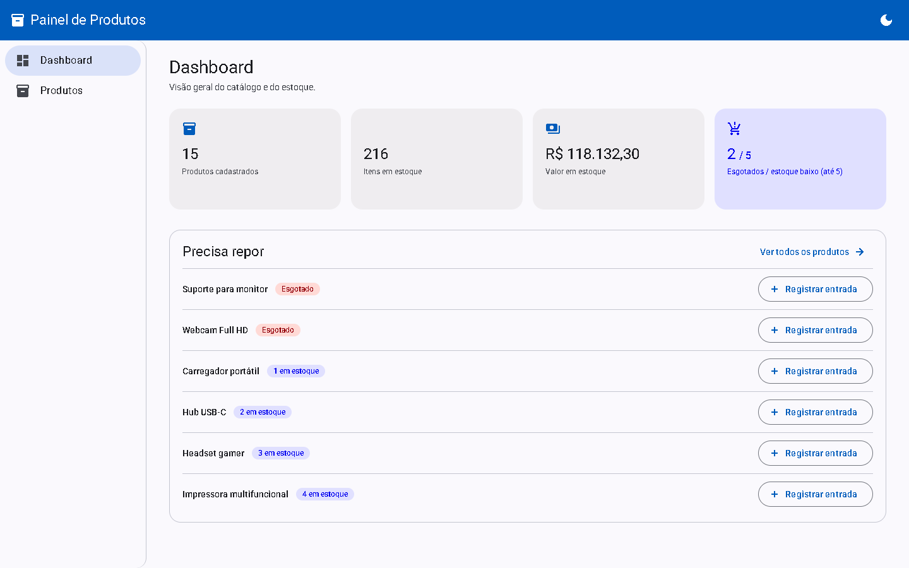
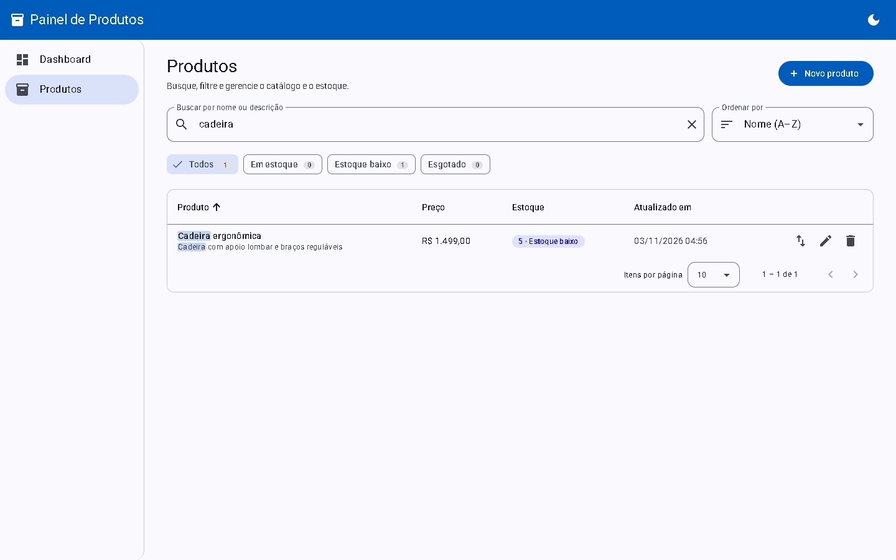
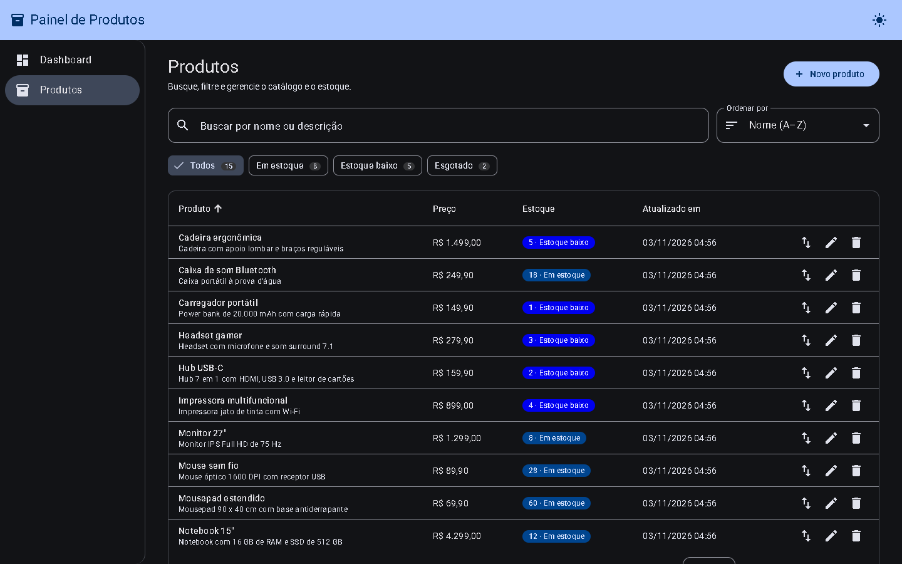
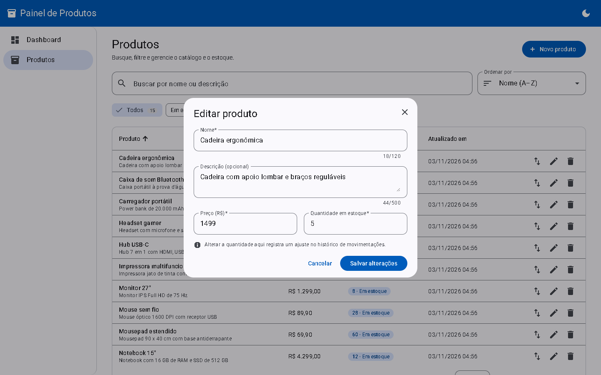
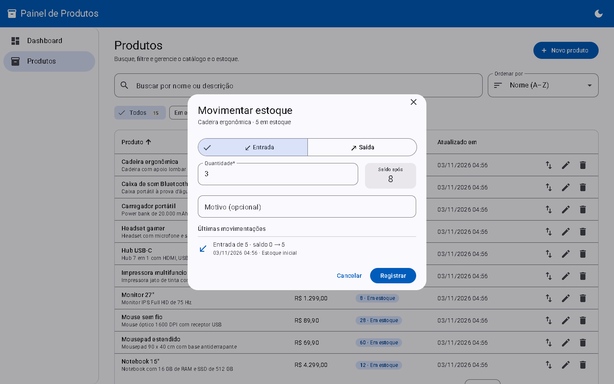
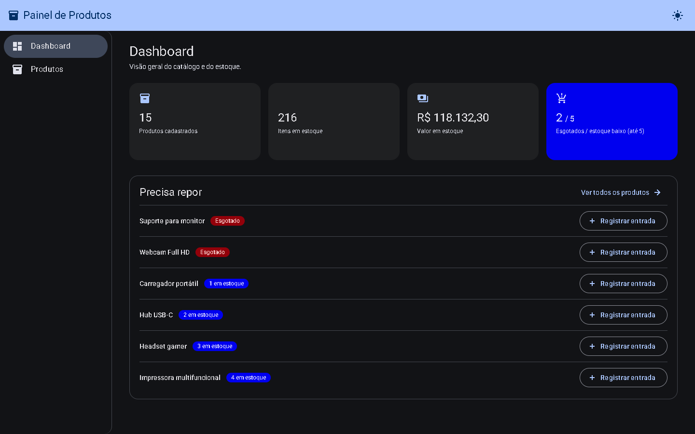

# Painel de Produtos

[](https://github.com/Chat809/product_module_interface/actions/workflows/ci.yml)


Painel administrativo em Angular para gerenciar produtos e estoque, com login, registro e papéis de usuário. Consome a [Produtos API](https://github.com/Chat809/product_module_api) (Spring Boot), publicada no Render.



## Links rápidos

| O quê | Link |
|---|---|
| Painel publicado (Vercel) | https://productmoduleinterface.vercel.app |
| API usada pelo painel (Render) | https://product-module-api.onrender.com/api/v1/produtos |
| Swagger UI da API (testar os endpoints no navegador) | https://product-module-api.onrender.com/swagger-ui.html |
| Health check da API | https://product-module-api.onrender.com/actuator/health |
| Repositório da API | https://github.com/Chat809/product_module_api |
| Execuções do CI | https://github.com/Chat809/product_module_interface/actions |

> A API roda no plano gratuito do Render: depois de um tempo sem uso, a primeira carga do painel pode levar até um minuto. O painel mostra um aviso enquanto isso.

## Telas

| Lista com busca instantânea e destaque | Modo escuro |
|---|---|
|  |  |

| Edição em modal | Movimentação de estoque com saldo previsto e histórico |
|---|---|
|  |  |



## Funcionalidades

- **Login e registro:** o painel abre na tela de login; quem não tem conta cria uma com nome, e-mail e senha e já entra como usuário. A sessão fica salva no navegador e é renovada automaticamente quando o token expira.
- **Papéis:** qualquer usuário logado gerencia produtos e estoque. Administradores também veem a página **Usuários**, onde listam as contas e promovem ou rebaixam papéis (com confirmação). A barra superior mostra o nome, o e-mail e o papel, com o botão **Sair**.
- **Dashboard:** indicadores do estoque (produtos, itens, valor total em reais, esgotados e estoque baixo) e a lista "Precisa repor", com atalho para registrar entrada.
- **Busca instantânea:** filtra enquanto você digita, ignora acentos e maiúsculas, aceita vários termos em qualquer ordem e destaca o trecho encontrado. Não faz requisição a cada tecla.
- **Filtros e ordenação:** chips por situação do estoque (todos, em estoque, estoque baixo, esgotado) com contagem, ordenação por nome, preço, estoque ou última atualização, e paginação em português.
- **Cadastro e edição em modal**, no mesmo formulário, com as mesmas regras de validação da API e erros exibidos no campo correspondente. Fechar com alterações pendentes pede confirmação.
- **Movimentações de estoque:** modal de entrada e saída com saldo previsto, aviso de estoque insuficiente e histórico das últimas movimentações.
- **Edição concorrente:** ao salvar, o painel envia a versão lida no cabeçalho `If-Match`. Se outra pessoa alterou o produto, a API responde 409; o painel avisa e recarrega os dados.
- **Avisos padronizados:** toasts com emoji por tipo (sucesso, erro, aviso, informação) e botão X para fechar.
- **Modo escuro**, com a preferência salva no navegador (o padrão segue o sistema operacional).
- **Layout responsivo** com menu lateral, que vira menu recolhível no celular; modais que se ajustam à altura da janela.
- Skeleton durante o carregamento, estados vazios e aviso de espera enquanto a API "acorda".

## Stack

- Angular 22 (componentes standalone, signals, zoneless, novo control flow e rotas com lazy loading)
- Angular Material 22 (Material 3)
- Reactive Forms
- Vitest (testes unitários)

## Pré-requisitos

- Node.js `^22.22.3` ou `^24.15.0`
- npm

## Como executar

```bash
git clone https://github.com/Chat809/product_module_interface.git
cd product_module_interface
npm install
npm start
```

Acesse `http://localhost:4200`.

Em desenvolvimento, o painel consome a API local em `http://localhost:8080/api/v1`. Para subi-la, siga o README da [Produtos API](https://github.com/Chat809/product_module_api#como-executar) (`./mvnw spring-boot:run`). A API sobe com 15 produtos de exemplo e precisa da variável `SUPABASE_SECRET_KEY` para o login funcionar.

Para usar a API publicada no Render sem rodar o backend localmente:

```bash
npm start -- --configuration production
```

| Ambiente | Arquivo | URL da API |
|---|---|---|
| Desenvolvimento | `src/environments/environment.development.ts` | `http://localhost:8080/api/v1` |
| Produção | `src/environments/environment.ts` | `https://product-module-api.onrender.com/api/v1` |

## Testes

```bash
npm test
```

São 93 testes com Vitest. Cada teste sobe um componente ou serviço isolado pelo `TestBed`, troca as dependências por objetos falsos (`vi.fn()`) ou intercepta o HTTP com `HttpTestingController`, e verifica o que aparece na tela e quais chamadas foram feitas.

| Arquivo | O que cobre |
|---|---|
| `produto.service.spec.ts` | URLs, parâmetros, métodos HTTP, corpo e cabeçalho `If-Match` de cada operação da API |
| `produto-filtro.spec.ts` | Normalização sem acentos, filtro por termos e situação, ordenação e destaque |
| `produto.store.spec.ts` | Carga única do catálogo e atualização local após cada operação |
| `produto-list.spec.ts` | Busca sem nova chamada à API, chips com contagem, ordenação, paginação, estado vazio e exclusão |
| `produto-form.spec.ts` | Validações, cadastro, edição com versão, conflito 409 e erros retornados pela API |
| `movimentacao-dialog.spec.ts` | Histórico, saldo previsto, bloqueio de saída maior que o estoque e registro |
| `dashboard.spec.ts` | Indicadores do resumo, lista de reposição ordenada e atalho de entrada |
| `error.interceptor.spec.ts` | Mensagem exibida para cada status (sem conexão, 400, 401, 403, 409, 422 e erro genérico) |
| `auth.service.spec.ts` | Login, registro, sessão salva e restaurada, renovação única para chamadas simultâneas e saída |
| `auth.interceptor.spec.ts` | Token só nas chamadas à API, renovação e repetição da requisição em 401, logout se a renovação falhar |
| `auth.guards.spec.ts` | Redirecionamento ao login guardando a rota, bloqueio da página de admin e saída do login para quem já entrou |
| `login.spec.ts` | Validação, cumprimento, retorno à rota pedida e limpeza da senha em caso de erro |
| `registro.spec.ts` | Regras iguais às da API, confirmação de senha, e-mail já cadastrado e erros por campo |
| `usuario.service.spec.ts` e `usuario-list.spec.ts` | Listagem paginada, marcação da própria conta, troca de papel com confirmação e recarga em caso de erro |
| `tema.service.spec.ts` | Preferência do sistema, escolha salva e troca de tema |
| `paginador-intl.spec.ts` | Rótulos da paginação em português |
| `toast.spec.ts` | Emoji por tipo, papel de acessibilidade e fechamento pelo botão X |
| `app.spec.ts` | Rotas: sem sessão, abre o login guardando a rota pedida; registro acessível sem login |

O workflow de CI (`.github/workflows/ci.yml`) roda o build e os testes a cada push e pull request.

## Build

```bash
npm run build
```

Os arquivos são gerados em `dist/product-module-interface/browser`.

## Estrutura

```
src/app
├── app.config.ts             Providers: rotas, HttpClient com interceptors, locale pt-BR, moeda BRL e paginação em português
├── app.routes.ts             Rotas com lazy loading e guards
├── auth                      Telas de login e de registro
├── core
│   ├── auth                  Sessão (AuthService), interceptor do token e guards
│   ├── feedback              Toast padronizado e serviço de notificação
│   ├── http                  Interceptor que traduz os erros da API (RFC 9457) em avisos
│   ├── i18n                  Textos do paginador em português
│   ├── layout                Shell: barra superior, menu lateral e área de conteúdo
│   └── tema                  Modo claro/escuro
├── shared
│   ├── confirm-dialog        Diálogo de confirmação reutilizável
│   ├── loading               Indicador de carregamento com aviso de partida a frio
│   ├── skeleton              Linhas de carregamento da tabela
│   └── somente-numeros       Diretiva que limita campos a caracteres numéricos
├── dashboard                 Indicadores e lista de reposição
└── produtos
    ├── produto.model.ts      Tipos que espelham os DTOs da API
    ├── produto.service.ts    Comunicação HTTP com a API
    ├── produto.store.ts      Catálogo em memória compartilhado pelas telas
    ├── produto-filtro.ts     Funções puras de busca, filtro, ordenação e destaque
    ├── produto-list          Tabela com busca, filtros, ordenação e paginação
    ├── produto-form          Modal de cadastro e edição
    └── movimentacao-dialog   Modal de entrada/saída com histórico
└── usuarios                  Página de usuários e troca de papel (somente admin)
```

| Rota | Página | Acesso |
|---|---|---|
| `/login` | Entrar | Sem sessão |
| `/registro` | Criar conta | Sem sessão |
| `/dashboard` | Indicadores e reposição (página inicial) | Logado |
| `/produtos` | Lista de produtos | Logado |
| `/usuarios` | Usuários e papéis | Administrador |

### Decisões

- **Organização por responsabilidade:** `core` (infraestrutura da aplicação), `shared` (componentes reutilizáveis), `dashboard` e `produtos` (as funcionalidades).
- **Busca em memória:** a API pagina e busca no servidor, mas o painel carrega o catálogo uma vez (até 500 produtos, o maior tamanho de página aceito) e filtra no navegador. Assim a busca responde a cada tecla sem requisições nem espera pela API no plano gratuito. Para catálogos maiores, bastaria trocar o filtro local pelos parâmetros `busca`, `page` e `sort` da API.
- **Store com signals:** um serviço com `signal` e `computed` guarda o catálogo e o atualiza localmente após cadastrar, editar, movimentar ou excluir. Para este escopo, uma biblioteca de estado (como NgRx) seria complexidade sem ganho.
- **Modais em vez de páginas:** cadastrar, editar e movimentar acontecem sem sair da lista, preservando busca, filtros e página.
- **Tratamento de erros centralizado:** o interceptor exibe a mensagem de qualquer erro HTTP; os componentes tratam apenas o que é específico deles, como os erros por campo no formulário.
- **Autenticação só pela API:** o painel nunca fala direto com o Supabase nem conhece nenhuma chave dele; envia e-mail e senha à API, que devolve o token. O `authInterceptor` anexa o token apenas às chamadas para a URL da API e, em um 401, renova a sessão uma única vez (chamadas simultâneas compartilham a mesma renovação, porque o Supabase invalida o refresh token a cada uso). Ele fica por dentro do `errorInterceptor`, então o aviso de sessão expirada só aparece se a renovação falhar.
- **Guards de rota:** `authGuard` protege o layout inteiro e guarda a rota pedida para voltar depois do login; `adminGuard` protege `/usuarios`. A API também confere o papel, então o guard é conveniência de navegação, não a barreira de segurança.
- **Concorrência pelo HTTP:** a versão do produto vai no cabeçalho `If-Match`, como recomenda a especificação do HTTP, e também no corpo, por compatibilidade.

## Deploy na Vercel

1. Importe o repositório na Vercel.
2. O preset **Angular** é detectado automaticamente. O `vercel.json` já define o comando de build, a pasta de saída e o redirecionamento das rotas para o `index.html`, para que recarregar a página em `/produtos` funcione.
3. Clique em **Deploy**.

A API libera CORS para `https://productmoduleinterface*.vercel.app` e `https://product-module-interface*.vercel.app`. Se o painel for publicado em outro domínio, adicione-o à variável `CORS_ALLOWED_ORIGINS` do serviço da API no Render.

## Referências

- [Angular](https://angular.dev/) e [Signals](https://angular.dev/guide/signals)
- [Angular Material](https://material.angular.dev/) e [Material Design 3](https://m3.material.io/)
- [Reactive Forms](https://angular.dev/guide/forms/reactive-forms)
- [Testes no Angular](https://angular.dev/guide/testing) e [Vitest](https://vitest.dev/)
- [HttpClient e interceptors](https://angular.dev/guide/http) e [guards de rota](https://angular.dev/guide/routing/route-guards)
- [Supabase Auth](https://supabase.com/docs/guides/auth) (usado pela API)
- [MDN: ETag e If-Match](https://developer.mozilla.org/docs/Web/HTTP/Headers/If-Match)
- [RFC 9457: Problem Details for HTTP APIs](https://www.rfc-editor.org/rfc/rfc9457)
- [Vercel: deploy de projetos Angular](https://vercel.com/docs/frameworks/frontend/angular)
- [GitHub Actions](https://docs.github.com/actions)
